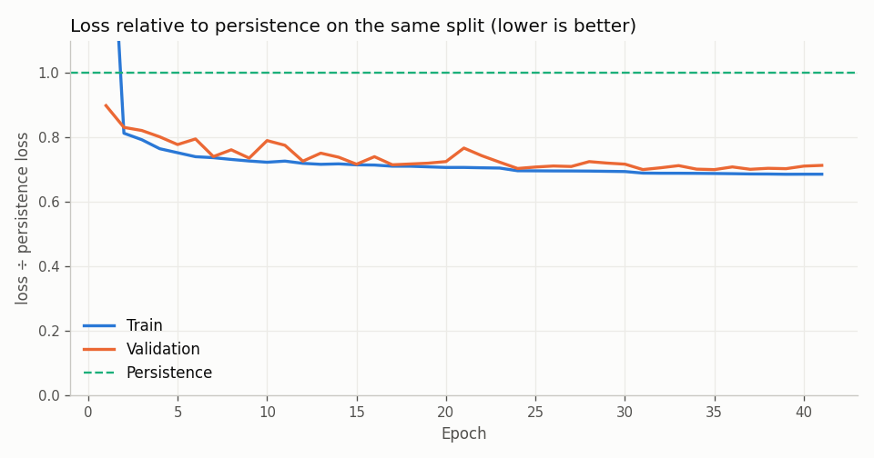
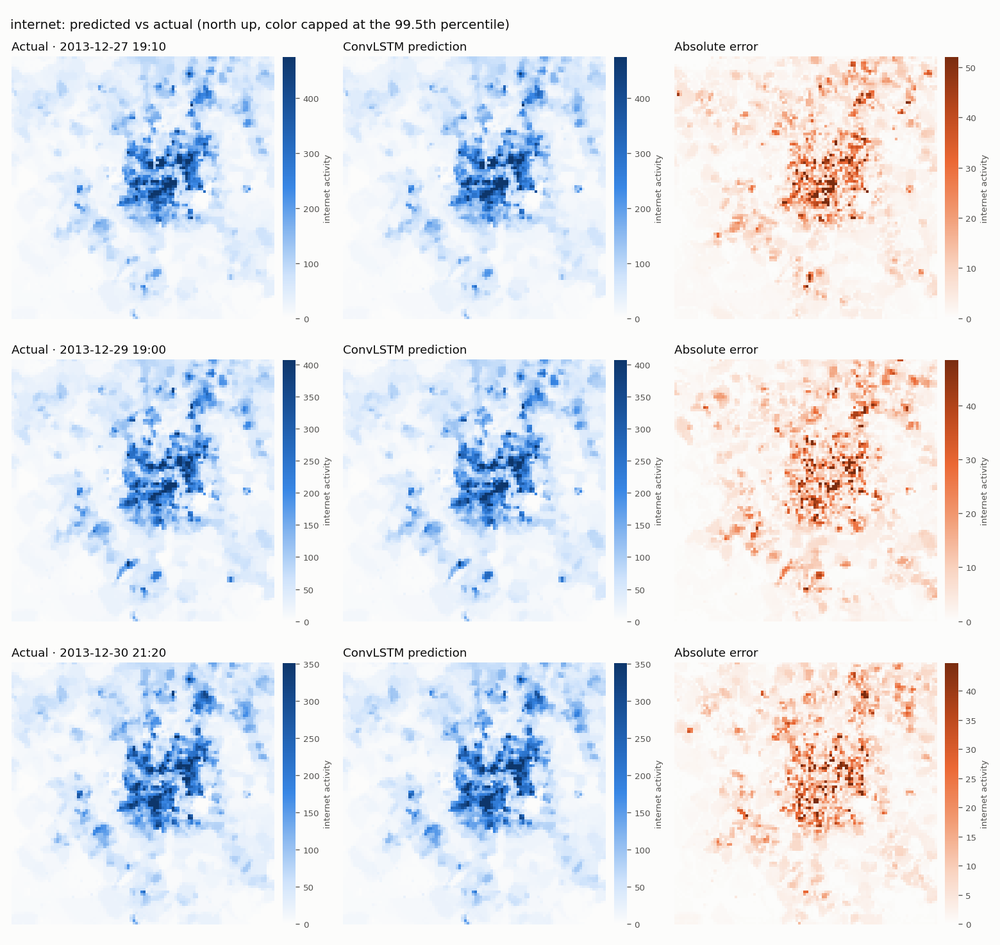
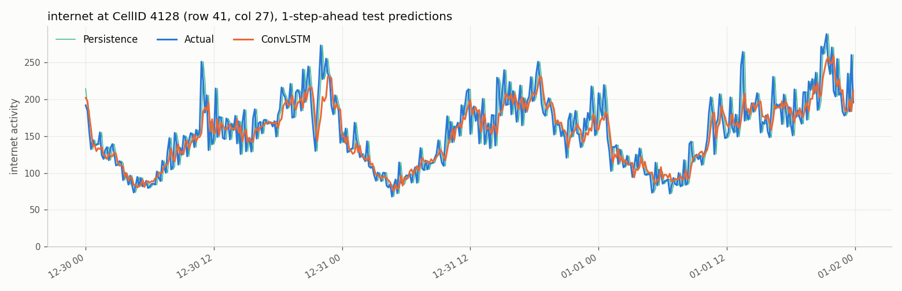

# Project Report and Presentation Guide

**Spatio-Temporal ConvLSTM for Cellular Traffic Prediction: Telecom Italia "Milano" Dataset**

This file brings together everything about the project in one place:

- what was built
- every finding and check made along the way
- the results of all three real-data runs, and how the model was improved between them
- what to show your professor, and how to answer likely questions

Related documents:

| File | Purpose |
|---|---|
| `README.md` | technical reference: setup, commands, configuration |
| `PROJECT_OVERVIEW.md` | plain-language explanation of the project |
| `outputs/kaggle/` | run 1 results: metrics, plots, logs, checkpoint |
| `outputs/kaggle_run2/` | run 2 results: plots, logs, config used, metrics summary |
| `outputs/kaggle_run3/` | run 3 (final model) results: plots, logs, config used, metrics summary |

Links:

- GitHub repository: <https://github.com/Hasini885/convlstm-milano-traffic-prediction>
- Kaggle notebooks: run 1 `hasinisaimaram/convlstm-milano-traffic-prediction`, run 2
  `hasinisaimaram/notebook270153270c` (version 2), run 3 `hasinisaimaram/notebookddcd7f3d64`
  (version 1). The run-3 notebook, with its outputs, is also in the repository as
  `kaggle/convlstm_milano_kaggle.ipynb`.

---

## Contents

1. [Summary in one page](#1-summary-in-one-page)
2. [Problem statement and motivation](#2-problem-statement-and-motivation)
3. [Dataset: description and findings](#3-dataset-description-and-findings)
4. [Preprocessing: what was done and why](#4-preprocessing-what-was-done-and-why)
5. [Model: ConvLSTM architecture](#5-model-convlstm-architecture)
6. [Training setup](#6-training-setup)
7. [Evaluation method and baselines](#7-evaluation-method-and-baselines)
8. [Review of run 1: drawbacks and fixes](#8-review-of-run-1-drawbacks-and-fixes)
9. [Results on the real data (with output plots and logs)](#9-results-on-the-real-data)
10. [Analysis and interpretation of the results](#10-analysis-and-interpretation-of-the-results)
11. [Engineering findings and problems solved](#11-engineering-findings-and-problems-solved)
12. [Limitations](#12-limitations)
13. [Future work and suggested experiments](#13-future-work-and-suggested-experiments)
14. [What to show your professor](#14-what-to-show-your-professor)
15. [Likely questions, with answers](#15-likely-questions-with-answers)
16. [How to reproduce everything](#16-how-to-reproduce-everything)
17. [Project timeline](#17-project-timeline)
18. [References and data citation](#18-references-and-data-citation)

---

## 1. Summary in one page

| Item | Value |
|---|---|
| Goal | Predict mobile internet traffic on every cell of a 100×100 grid over Milan, 10 minutes ahead, from the previous 1 hour |
| Data | Telecom Italia Big Data Challenge: 62 days (2013-11-01 to 2014-01-01), 10-minute resolution, 10,000 cells, 5 activity types |
| Model | 2-layer ConvLSTM (hidden 64, 3×3 kernels) plus a convolutional prediction head; 473,506 parameters (1 traffic channel + 4 calendar channels) |
| Final setup (run 3) | `log1p` + standard scaling, time-of-day/day-of-week inputs, masked MSE, Adam, ReduceLROnPlateau, early stopping; Kaggle Tesla T4, 41 epochs, about 1 h 47 min |
| Test period | 2013-12-23 17:40 to 2014-01-01 23:50 (Christmas and New Year), 1,334 forecasts × 10,000 cells |
| **Result (run 3)** | **ConvLSTM RMSE 8.47 / MAE 3.78 / MAPE 10.59%** |
| Best baseline | Persistence (repeat the last frame): RMSE 9.39 / MAE 4.33 / MAPE 12.56% |
| Improvement vs persistence | **−9.8% RMSE, −12.8% MAE, −15.7% MAPE** |
| Improvement vs run 1 | RMSE equal (8.47), **MAE −3.2%, MAPE −11.7%** |
| Generalisation | relative to persistence on the same split, training 0.69× and validation 0.70×: no overfitting |

**In one sentence:** a ConvLSTM trained on the full real Milan dataset predicts 10-minute-ahead
internet traffic across the whole city about 10% more accurately than the strongest naive
baseline (13% on MAE, 16% on MAPE), with no data leakage between training and test periods; a
review of the first version and two further runs cut its percentage error by a further 11.7%.

---

## 2. Problem statement and motivation

Mobile networks have to provide capacity where and when people use it. Traffic changes quickly
in both **space** (a crowd moves from the station to the stadium) and **time** (daily rhythms,
evening peaks, holidays).

If an operator can forecast traffic for each area a few minutes ahead, it can act before
congestion happens:

- move bandwidth to where it will be needed
- switch cells on and off to save energy
- balance load between cells

**Research question:** given the traffic on a 100×100 grid over the last hour, can a
spatio-temporal deep-learning model predict the traffic for the next 10 minutes better than
simple rules such as "the next 10 minutes will look like the last 10" or "it will be like this
time yesterday"?

**Why this is a spatio-temporal problem:** each 10-minute snapshot of the city is an image
(a 100×100 "pixel" grid where brightness is traffic), and the sequence of snapshots is a video.
Forecasting is predicting the next frame, which needs a model that understands spatial
neighbourhoods and temporal dynamics at the same time.

---

## 3. Dataset: description and findings

### 3.1 Description

- **Source:** Telecom Italia Big Data Challenge, "Telecommunications - SMS, Call, Internet - MI",
  Harvard Dataverse, doi:10.7910/DVN/EGZHFV.
- **Spatial unit:** Milan is split into 100×100 = 10,000 square cells of about 235 m × 235 m,
  numbered with `CellID` 1–10,000.
- **Temporal unit:** 10-minute intervals. That is 144 per day; over 62 days, T = 8,928 time steps.
- **Five activity types (channels):** `smsin`, `smsout`, `callin`, `callout`, `internet`. The
  values are anonymised, scaled activity levels, not raw counts.
- **Raw format:** one file per day (`sms-call-internet-mi-YYYY-MM-DD.txt`), tab-separated, no
  header. Columns: cell ID, time interval (milliseconds since epoch, UTC), country code, then
  the five activity values.

### 3.2 Findings about the data

1. **One row per (cell, time, country code).** Traffic is split by the country of the foreign
   party, so rows must be **summed over country codes** to get the total per cell.
2. **The data is sparse.** A row only exists when there was activity, and individual fields are
   empty when that activity type was zero. A missing value therefore means "no activity", not
   "unknown". This drove the missing-value decision (§4).
3. **Timestamps are UTC.** They must be converted to Milan local time (Europe/Rome, UTC+1 in
   winter) so that days and daily cycles line up with local life. The first record,
   `1383260400000` ms, is 2013-10-31 23:00 UTC, which is 2013-11-01 00:00 in Milan.
4. **Size.** About 300–360 MB per day uncompressed, 20.8 GB in total. The first day holds
   1,439,982 (time, cell) records after aggregation.
5. **Every cell is active.** All 10,000 cells had some internet activity during the training
   period, so the "inactive cell" mask removed nothing on the real data.
6. **Heavy-tailed values.** A handful of city-centre cells are hundreds of times busier than the
   typical cell. With min-max scaling this squeezes almost every value close to 0 (§8).
7. **The periods differ in difficulty.** November (training) is busier and harder to predict
   than mid-December (validation): even persistence scores 1.64× more loss on the training
   period than on the validation period (run 3, log-standardised scale).
8. **Grid orientation verified.** In `milano-grid.geojson`, CellID 1 is the south-west corner,
   CellID 2 lies east of it and CellID 101 north of it, so `row = (id−1) // 100` runs south to
   north and `col = (id−1) % 100` west to east, as the code assumes.
9. **Access.** Harvard Dataverse requires a **guestbook form** before any download. Its API
   answers scripted downloads with HTTP 400 ("You may not download this file without the
   required Guestbook response") and rejects Python's default user agent (HTTP 403).
10. **Kaggle mirror verified.** The Kaggle dataset `dkgmgo/telecom-italia-milan` contains all 62
    daily files plus `milano-grid.geojson`. **All 62 files match the official Dataverse release
    byte for byte** (file sizes compared against the Dataverse API listing), so the experiments
    use the original, complete data.
11. **Other mirrors are incomplete or different.** For example, `marcodena/mobile-phone-activity`
    holds only 7 days in CSV form, and `freckled/telecom` holds two large merged CSVs. These were
    not used.

---

## 4. Preprocessing: what was done and why

Implemented in `src/dataset.py` (`preprocess()`).

| Step | What it does | Why |
|---|---|---|
| 1. Discover files | Finds the daily files and sorts them by the date in the name | Supports `.txt`, `.csv` and gzip-compressed versions |
| 2. Read and aggregate | Reads each day; sums rows over country codes (empty fields stay empty unless at least one value exists) | Total traffic per cell |
| 3. Time conversion | UTC epoch ms → Milan local time | Daily cycles match local time |
| 4. Grid mapping | `row = (CellID−1) // 100`, `col = (CellID−1) % 100` | Verified against the geojson (finding 3.2.8); row 0 is the southern edge, so plots use `origin="lower"` (north up) |
| 5. Absolute time index | `t = (time − origin) / 10 min`; origin = local midnight of the first day | Records that cross midnight (because of the UTC shift) land in the right slot |
| 6. Tensor storage | float32 `.npy` memory-mapped file of shape **(T, C, H, W) = (8928, 5, 100, 100)**, about 1.8 GB | The full tensor never needs to fit in RAM |
| 7. Missing values | **Zero-fill** (default); forward-fill + zero-fill available | Missing = no activity (finding 3.2.2); forward-filling would invent traffic |
| 8. Metadata | `meta.json`: features, shape, origin, interval, fill method, list of days | Reproducibility |

Then, when building the datasets (`build_datasets()`):

- **Chronological split 70/15/15** of the time axis:
  - Train: 2013-11-01 00:00 → 2013-12-14 09:30 (6,249 steps)
  - Validation: 2013-12-14 09:30 → 2013-12-23 16:40 (1,339 steps)
  - Test: 2013-12-23 16:40 → 2014-01-02 00:00 (1,340 steps)
- **Every sliding window lies entirely inside one split,** so no target from a later period
  is ever seen during training (no temporal leakage).
- **Scaling, fitted on the training segment only,** so no test statistics leak into training:
  - run 1: per-channel min-max to [0, 1]
  - run 2: per-channel standardisation (mean 0, standard deviation 1)
  - run 3 (final): `log1p`, then per-channel standardisation
- **Calendar inputs** (runs 2 and 3): four extra input channels per frame: sin and cos of the
  time of day, and sin and cos of the position in the week, each a constant plane over the grid.
  They are computed from the time index, so no extra data is needed; sin/cos makes 23:50 and
  00:00 neighbours.
- **Sliding windows:** input X = 6 frames (1 hour), target Y = the next 1 frame (10 minutes).
  That gives 6,243 training, 1,333 validation and 1,334 test windows.
- **Mask:** cells with zero activity over the entire training period are excluded from loss and
  metrics. (On the real data none were excluded; see finding 3.2.5.)

---

## 5. Model: ConvLSTM architecture

Implemented in `src/model.py`.

```
Input  X: (B, 6, 5, 100, 100)        6 past frames: internet traffic + 4 calendar channels
  │
  ▼
ConvLSTM layer 1 (5 → 64 channels, 3×3)
  │   hidden-state sequence (B, 6, 64, 100, 100)
  ▼
ConvLSTM layer 2 (64 → 64 channels, 3×3)
  │   final hidden state h_T (B, 64, 100, 100)
  ▼
Prediction head
  ├─ 1×1 Conv: 64 → 1                        coarse forecast
  └─ refinement: [coarse ‖ h_T] → 3×3 Conv (32) → ReLU → 3×3 Conv (1) → + coarse
  │
  ▼
Output Ŷ: (B, 1, 1, 100, 100)        next frame of internet traffic
```

### 5.1 ConvLSTM cell (Shi et al., 2015)

The input and the previous hidden state are concatenated along channels. **One** convolution
produces all four gates:

- input gate `i = σ(·)`, forget gate `f = σ(·)`, output gate `o = σ(·)`
- candidate `g = tanh(·)`
- cell state `c_t = f ⊙ c_{t−1} + i ⊙ g`
- hidden state `h_t = o ⊙ tanh(c_t)`

It differs from a normal LSTM in that the states are **images** (64 × 100 × 100), and the
gates are computed with **convolutions** instead of fully connected layers. Each cell therefore
decides what to remember based on itself *and its neighbours*.

Details:

- "Same" padding keeps the 100×100 size.
- The forget-gate bias starts at 1, a standard trick for stable early training.
- Hidden states start at zero.

### 5.2 Prediction head

- A 1×1 convolution maps the 64 hidden channels to the forecast. A small residual stack of
  3×3 convolutions then refines it spatially.
- Multi-step forecasting (if `t_out > 1`) is **direct**: all future frames come out at once,
  with no autoregressive error build-up.

### 5.3 Size

| Configuration | Parameters |
|---|---|
| 1 input channel (run 1) | 464,290 |
| 1 input channel + 4 calendar channels (runs 2 and 3) | **473,506** |
| 5 traffic channels + 4 calendar channels | 482,722 |

---

## 6. Training setup

Implemented in `src/train.py`; configuration in `configs/default.yaml` and `configs/kaggle.yaml`.

| Setting | Run 1 | Runs 2 and 3 |
|---|---|---|
| Loss | masked MSE on the normalised scale | same |
| Optimiser | Adam, learning rate 1e-3 | same |
| LR scheduler | ReduceLROnPlateau on validation loss: factor 0.5, patience 5, min 1e-6 | same |
| Early stopping | patience 10, any improvement resets it | patience 10, only improvements > 0.1% reset it (`min_delta_rel: 0.001`); the best model is still always saved |
| Reference loss | none | persistence scored once on the training and validation sets; every loss also logged as "N× persistence" |
| Epoch loss | mean over batches | mean over samples (the short last batch no longer over-counts) |
| Max epochs / batch size | 100 / 16 | same |
| Gradient clipping | max norm 1.0 | same |
| Mixed precision | float16 autocast + GradScaler on CUDA | same |
| Time budget | 8.5 h (stop cleanly before Kaggle's 12 h limit) | same, plus `--resume` from `last_checkpoint.pt` after an interruption |
| Seed | 42 (Python, NumPy, PyTorch) | same, plus a seeded generator for the shuffle order |
| Hardware | Kaggle **Tesla T4** GPU, PyTorch 2.11 (CUDA 13.0) | same |
| Checkpointing | best model by validation loss → `best_model.pt` (weights, config, normaliser, channel info) | same, plus `last_checkpoint.pt` every epoch |

---

## 7. Evaluation method and baselines

Implemented in `src/evaluate.py`.

- Predictions are **converted back to original units** before scoring (including undoing the
  log transform), and clamped to ≥ 0 because traffic can't be negative.
- **Metrics,** over all test windows × all active cells:
  - **RMSE** (root mean squared error): penalises large errors more, so it is dominated by the
    busiest cells.
  - **MAE** (mean absolute error): the average size of the error.
  - **MAPE** (mean absolute percentage error): relative error, counting only cells whose true
    value is > 1.0, because MAPE explodes near zero. Every cell counts equally.
- Metrics are reported overall, per prediction horizon and per channel, and accumulated
  incrementally so the test set never has to sit in memory.
- **Baselines:**
  - **Persistence:** the last observed frame ("the next 10 minutes look like the last 10").
    Very strong for short-term forecasting.
  - **Window mean:** the average of the 6 input frames (historical average).
  - **Same time yesterday** (`SeasonalDaily`) and **same time last week** (`SeasonalWeekly`),
    added after run 1. They look back into the training/validation period, which is legitimate:
    at forecast time those frames are already known.
- **Skill score:** for each baseline, the share of its RMSE and MAE that the ConvLSTM removes
  (`metrics.json`, `ConvLSTM.skill_vs_baselines_%`).
- **Plots:**
  - `heatmaps.png`: actual, predicted and absolute error for 3 random test times
  - `cell_timeseries.png`: the last 3 days of the test period for a busy cell
  - `loss_curve.png`: training and validation loss per epoch, each divided by the persistence
    loss on the same split, with a line at 1.0 (= persistence) (run 3; earlier runs show raw
    losses)

---

## 8. Review of run 1: drawbacks and fixes

After run 1, the code, the results and the plots were reviewed. These were the drawbacks found
and the fixes made before runs 2 and 3:

| # | Drawback in run 1 | Fix |
|---|---|---|
| 1 | **Min-max scaling squeezed the data.** A few very busy cells set the maximum, so almost every value sat near 0 and the training loss was about 6e-6, which leaves the optimiser little signal. | `data.scaler: standard` (mean/std); losses are now of order 1e-2. In run 3 also `log1p` first. |
| 2 | **No notion of time.** One hour of history cannot tell 08:00 (traffic about to rise) from 20:00 (about to fall). | `data.time_features: true`: 4 calendar input channels. |
| 3 | **Weak baselines.** Only "last frame" and "last-hour mean". | Same-time-yesterday and same-time-last-week baselines, plus skill scores. |
| 4 | **Early stopping fooled by tiny gains.** Improvements in the 7th digit kept a converged run going about 40 more epochs. | `training.min_delta_rel: 0.001`. |
| 5 | **The loss curve was misleading.** Validation sat below training and nothing showed whether the model beat a baseline. | Persistence scored on both splits; the loss curve now shows each loss ÷ persistence on the same split, with a line at 1.0. |
| 6 | **No resume.** A Kaggle timeout lost the whole run. | `--resume` from `last_checkpoint.pt`. |
| 7 | **Small bugs:** batch-mean loss, the logged learning rate was one epoch ahead, unseeded shuffle order, logs appended across runs. | Fixed. |
| 8 | **Unreadable time-series plot** (10 days of 10-minute data in one panel). | Last 3 days only (`evaluation.plot_steps`). |
| 9 | **Download script could not work** (Dataverse guestbook). | Replaced by `scripts/download_kaggle.py`; unused `scikit-learn` removed. |
| 10 | **Grid orientation unverified.** | Verified against the geojson (finding 3.2.8). |
| 11 | **Large gap between training and validation loss.** | Not overfitting (validation is *below* training): the validation period is easier for every forecaster (finding 3.2.7), so raw losses from different periods are not comparable. Compared against persistence on the same split, the gap disappears (§9.3). |

All new options default to the run-1 behaviour in `configs/default.yaml`, so the run-1 checkpoint
and commands still work; `configs/kaggle.yaml` switches them on.

---

## 9. Results on the real data

All three runs use the same data, split, task (internet, 6 frames in → 1 frame out), model size
and test period, so their test metrics are directly comparable.

| Run | Changes | Notebook | Outputs |
|---|---|---|---|
| 1 | min-max scaling | `convlstm-milano-traffic-prediction` v1, 2026-11-03 | `outputs/kaggle/` |
| 2 | standard scaling, calendar inputs, `min_delta_rel` | `notebook270153270c` v2, 2026-11-16 | `outputs/kaggle_run2/` |
| 3 | run 2 + `log_transform` | `notebookddcd7f3d64` v1, 2026-11-16 | `outputs/kaggle_run3/` |

### 9.1 Run details

| Item | Run 1 | Run 2 | Run 3 (final) |
|---|---|---|---|
| Preprocessing | about 11 min | about 7 min | about 6.6 min |
| Time per epoch | about 147 s | about 162 s | about 156 s |
| Epochs (best) | 51 (41) | 35 (26) | 41 (35) |
| Learning-rate reductions | epochs 19, 33, 47 | epochs 23, 33 | epochs 24, 31 |
| Training time | about 2 h 5 min | about 1 h 35 min | about 1 h 47 min |
| Best validation loss | 1.83e-6 (min-max scale) | 6.59e-3 = 0.801× persistence | 9.23e-3 = **0.700× persistence** |

The raw losses of different runs are on different scales and cannot be compared with each
other; the persistence ratio can.

### 9.2 Test-set metrics (original units)

| Model | RMSE | MAE | MAPE % |
|---|---|---|---|
| **ConvLSTM, run 3 (final)** | **8.4722** | **3.7802** | **10.59** |
| ConvLSTM, run 1 | 8.4745 | 3.9071 | 11.99 |
| ConvLSTM, run 2 | 8.6032 | 3.9130 | 12.32 |
| Persistence (last frame) | 9.3922 | 4.3344 | 12.56 |
| Window mean (last hour) | 10.3727 | 4.4394 | 12.13 |
| Same time yesterday | 27.4455 | 9.2972 | 24.78 |
| Same time last week | 57.0111 | 17.4023 | 40.56 |

The baselines do not depend on the model, so their numbers are identical in every run.

### 9.3 Improvement of the final ConvLSTM

| Compared with | RMSE | MAE | MAPE |
|---|---|---|---|
| Persistence | **−9.8%** | **−12.8%** | **−15.7%** |
| Window mean | −18.3% | −14.9% | −12.7% |
| Same time yesterday | −69.1% | −59.3% | −57.3% |
| Same time last week | −85.1% | −78.3% | −73.9% |
| ConvLSTM run 1 | −0.03% (equal) | **−3.2%** | **−11.7%** |

**The final ConvLSTM beats every baseline on every metric, and improves on run 1 in MAE and
MAPE while matching it on RMSE.**

Generalisation check (run 3, best epoch 35): training loss 0.688× and validation loss 0.700×
the persistence loss of the same split. The two are nearly equal, so there is no overfitting.

### 9.4 Output plots (final model, from `outputs/kaggle_run3/`)

#### Figure 1: loss relative to persistence



*Each split's loss divided by the persistence loss on the same split; the dashed line at 1.0 is
persistence.*

Both curves are below persistence from the first epochs and settle around 0.69–0.70. Training
and validation overlap, which shows that the model generalises to the later period. (For
comparison, run 1's raw-loss curve is in `outputs/kaggle/loss_curve.png`: there validation sat
below training on a log scale around 1e-6, which looked worrying but only reflected the easier
validation period.)

#### Figure 2: predicted vs actual traffic maps



*Test times 2013-12-27 19:10, 2013-12-29 19:00 and 2013-12-30 21:20. Left: actual internet
traffic. Middle: ConvLSTM prediction. Right: absolute error. North is up.*

The predicted maps reproduce Milan's spatial structure: the dense city centre and the suburban
hotspots (stations, shopping areas, the airport region). The absolute error is concentrated in
the busy centre, where traffic levels are highest.

#### Figure 3: time series for one busy cell



*CellID 4128 (row 41, col 27), last 3 days of the test period (30 Dec – 1 Jan): actual (blue),
ConvLSTM (orange) and persistence (green).*

The prediction follows the daily cycle (night lows around 70–100, daytime highs around 250)
through New Year's Eve. Persistence copies every spike one step late; the ConvLSTM smooths the
unpredictable spikes and tracks the underlying level, which is why its errors are smaller.

### 9.5 Console output from the final run

These are the actual logs from run 3, in `outputs/kaggle_run3/preprocess.log`, `train.log` and
`evaluate.log`. Times are in UTC.

**Environment and data detection:**

```text
torch 2.11.0+cu130 | CUDA: True | Tesla T4
/kaggle/working: 20.9 GB free
/kaggle/temp: 1038.2 GB free
62 raw files in /kaggle/input/datasets/dkgmgo/telecom-italia-milan/data
first: sms-call-internet-mi-2013-11-01.txt | last: sms-call-internet-mi-2014-01-01.txt
1,439,982 (time, cell) records in the first file; time step = 10 min; 10,000 distinct cells
```

**Preprocessing:**

```text
17:40:31 | INFO | Building tensor (8928, 5, 100, 100) from 62 files [2013-11-01 .. 2014-01-01]
17:40:37 | INFO |   [1/62] sms-call-internet-mi-2013-11-01.txt: 1,439,982 (time, cell) records
   ...
17:47:08 | INFO |   [62/62] sms-call-internet-mi-2014-01-01.txt: 1,438,701 (time, cell) records
17:47:09 | INFO | Done. Metadata written to /kaggle/temp/processed/meta.json
```

**Training (first and last epochs):**

```text
17:47:18 | INFO | Device: cuda | windows train/val/test = 6243/1333/1334
17:47:18 | INFO | Loss mask: 10000/10000 cells active in the training period
17:47:18 | INFO | Model: 473,506 parameters
17:47:31 | INFO | Reference: persistence scores a train loss of 2.1577e-02 and a val loss of 1.3183e-02
17:50:09 | INFO | Epoch   1 | train 3.9090e-02 | val 1.1850e-02 (0.899x persistence) | lr 1.00e-03 | 158.2s  * saved best
17:52:45 | INFO | Epoch   2 | train 1.7547e-02 | val 1.0960e-02 (0.831x persistence) | lr 1.00e-03 | 155.8s  * saved best
   ...
19:18:27 | INFO | Epoch  35 | train 1.4853e-02 | val 9.2335e-03 (0.700x persistence) | lr 2.50e-04 | 156.9s  * saved best
   ...
19:34:08 | INFO | Epoch  41 | train 1.4805e-02 | val 9.4062e-03 (0.714x persistence) | lr 2.50e-04 | 156.5s
19:34:08 | INFO | Early stopping: no noticeable val improvement for 10 epochs
19:34:08 | INFO | Best val loss 9.2335e-03 (0.700x persistence)
```

**Evaluation:**

```text
19:34:17 | INFO | Loaded best_model.pt (epoch 35, val loss 9.2335e-03); 1334 test windows on cuda
19:34:43 | INFO | ConvLSTM       overall  RMSE 8.4722 | MAE 3.7802 | MAPE 10.59%
19:34:43 | INFO | Persistence    overall  RMSE 9.3922 | MAE 4.3344 | MAPE 12.56%
19:34:43 | INFO | WindowMean     overall  RMSE 10.3727 | MAE 4.4394 | MAPE 12.13%
19:34:43 | INFO | SeasonalDaily  overall  RMSE 27.4455 | MAE 9.2972 | MAPE 24.78%
19:34:43 | INFO | SeasonalWeekly overall  RMSE 57.0111 | MAE 17.4023 | MAPE 40.56%
19:34:43 | INFO | ConvLSTM vs Persistence    RMSE -9.8% | MAE -12.8%
19:34:43 | INFO | ConvLSTM vs WindowMean     RMSE -18.3% | MAE -14.8%
```

---

## 10. Analysis and interpretation of the results

1. **Beating persistence is the key result.** For 10-minute-ahead traffic, "repeat the last
   frame" is very hard to beat, because traffic changes little in 10 minutes. The final model's
   10% lower RMSE, 13% lower MAE and 16% lower MAPE show that the ConvLSTM really uses the
   spatial and temporal context: trends over the hour, and neighbouring cells.
2. **The log transform is what improved on run 1.** Run 2 → run 3 changed only
   `log_transform`, and moved MAE from 3.91 to 3.78 and MAPE from 12.32% to 10.59%. Training on
   a log scale makes the loss weight *relative* errors, so the many medium- and low-traffic
   cells are predicted better. RMSE, which is dominated by the few busiest cells, stayed at
   8.47. This is why the improvement shows in MAE and MAPE rather than RMSE.
3. **Standard scaling and calendar inputs fixed the training, not the accuracy.** Run 2's losses
   are of order 1e-2 instead of 1e-6, the scheduler now reduces the learning rate, and early
   stopping ends 16 epochs sooner, but its test RMSE was 1.5% *worse* than run 1. At a
   10-minute horizon the last hour of traffic already carries almost all the information; the
   time of day adds little. Calendar inputs should matter more for longer horizons.
4. **The seasonal baselines are far worse than persistence** (RMSE 27 and 57 against 9). At
   10-minute resolution, traffic in one cell is noisy, so even a perfect daily pattern misses the
   minute-to-minute level; and the test period (Christmas to New Year) differs strongly from the
   day and the week before it. "Same time last week" compares the holidays with a normal
   working week, which is why it is the worst.
5. **Persistence is stronger than the window mean** (RMSE 9.39 vs 10.37). Real traffic is smooth
   over 10 minutes but drifts over an hour, so averaging the whole hour lags behind trends.
6. **Errors are concentrated in the city centre.** Absolute errors scale with traffic level, so
   the busiest cells have the largest errors (see the heatmaps). In relative terms the model is
   consistent across the city.
7. **Validation loss below training loss is not leakage.** The split is strictly chronological
   and the scaling uses training statistics only. The validation period is simply easier: even
   persistence has 1.64× more loss on the training period. Measured against persistence on each
   split, the model scores 0.69× and 0.70×, so there is no generalisation gap.
8. **The test period is unusual and hard.** Christmas and New Year have different behaviour
   from the training period (less commuting, holiday patterns). The model still beats every
   baseline there, which suggests it generalises.

---

## 11. Engineering findings and problems solved

| Problem | Finding | Solution |
|---|---|---|
| Raw data has one row per country code | Totals per cell need aggregation | Sum over country codes during reading |
| Sparse records, empty fields | Missing means no activity | Zero-fill by default; forward-fill as an option |
| UTC timestamps | Days would be shifted by an hour | Convert to Europe/Rome; absolute time indexing |
| 1.8 GB tensor | Too big to keep in RAM comfortably | Memory-mapped `.npy`, opened lazily in each DataLoader worker |
| Possible temporal leakage | Random splits leak the future | Chronological split; windows confined to one split; scaling fitted on training only |
| Residual model collapsed to persistence | Found in early tests | Turned residual mode off by default |
| Min-max scaling squeezed the data | Training loss ~6e-6 | Standard scaling, then `log1p` + standard scaling |
| Misleading loss curve | Validation below training on raw losses | Losses plotted relative to persistence on the same split |
| Dataverse guestbook blocks downloads | HTTP 400 without a guestbook response; 403 for the Python user agent | Used the Kaggle mirror, verified byte for byte; `scripts/download_kaggle.py` |
| Disk space for raw data | 20.8 GB uncompressed | Preprocessing reads `.gz` directly |
| Kaggle's 12-hour session limit | Training must not stop evaluation from running | `training.max_hours` budget (8.5 h) and `--resume` |
| Kaggle runs in the browser editor stop | Two attempts were lost when interactive sessions ended | Run with "Save Version → Save & Run All (Commit)", which continues with the browser closed |
| Code upload to Kaggle | Re-zipping and uploading the code for every change was error-prone | Self-contained notebook that writes `src/` and `configs/` itself; only the data is attached |
| No GPU on the laptop | Full-grid training is impractical on CPU | Ran on a Kaggle T4 GPU; changes smoke-tested locally on a few real days |
| Windows locks open PNGs | `OSError: [Errno 22]` when re-saving a plot open in a viewer | Write to another folder, or close the viewer |
| Kaggle CLI on Windows | Garbles absolute paths | Call it with relative paths |

---

## 12. Limitations

1. **The improvement over run 1 is in MAE and MAPE, not RMSE.** RMSE, which is dominated by the
   busiest cells, is unchanged at 8.47.
2. **One run per configuration** (seed 42). Differences of about 1% may be within run-to-run
   variation; the 11.7% MAPE gain is well beyond that.
3. **Changes were not all tested one at a time.** Run 2 → run 3 isolates `log_transform`, but
   standard scaling and calendar inputs were introduced together in run 2.
4. **One task on real data:** internet only, one step (10 minutes) ahead, no hyperparameter
   search.
5. **Single test period,** and it is a holiday period. Results on a normal working week might
   differ.
6. **No external information** beyond the calendar: no holiday flags, weather or events.
7. **Point forecasts only,** with no uncertainty estimate.
8. **Compute:** training used a free Kaggle T4; larger models or longer horizons would need more
   GPU time.

---

## 13. Future work and suggested experiments

Each experiment is one Kaggle run (about 2 hours) with a single config change on top of run 3:

| Experiment | Config change | Question it answers |
|---|---|---|
| **Longer horizons** | `data.t_out=3` (30 min) or `6` (1 h) | How quickly does accuracy decay? Do calendar inputs help more further ahead? |
| **All five features as input** | `data.input_features=[smsin,smsout,callin,callout,internet]` | Do SMS and call activity help predict internet traffic? |
| **Ablations** | `data.time_features=false`, or `data.scaler=minmax` with `log_transform=true` | What does each run-2 change contribute on its own? |
| **Repeated seeds** | `seed=1,2,3` | How large is the run-to-run variation? |
| **Longer history** | `data.t_in=12` or `18` | Does more past context help? |
| **Model size** | `model.hidden_dim=32/128`, `model.num_layers=1/3` | Accuracy vs compute trade-off |
| **Other targets** | `data.target_features=[callin]` | Does the method transfer to calls and SMS? |

Further ideas:

- holiday flags as inputs
- an encoder–decoder (seq2seq) head for long horizons
- comparison with other models: CNN, LSTM, PredRNN, graph neural networks
- uncertainty estimation

---

## 14. What to show your professor

Present it as a story: **problem → data → method → first results → review and improvements →
final results → what you learned.**

### Suggested presentation (12–13 slides)

| # | Slide | Content | Material |
|---|---|---|---|
| 1 | Title | project title, your name, guide | |
| 2 | Problem and motivation | why operators need traffic forecasts; the research question | §2 |
| 3 | Dataset | Milan grid, 10-minute steps, 62 days, 5 activities; data challenges found | §3; left column of `heatmaps.png` |
| 4 | The key idea | the city as a video → next-frame prediction | §2 |
| 5 | Preprocessing | aggregation, time conversion, grid mapping, tensor (8928, 5, 100, 100); missing values | §4 |
| 6 | Avoiding leakage | chronological split, train-only scaling, windows inside splits | §4 |
| 7 | Model | ConvLSTM cell equations and architecture diagram | §5 |
| 8 | Training | settings table; T4 GPU; early stopping; loss relative to persistence | §6, run-3 `loss_curve.png` |
| 9 | Run 1 and its review | first results; the drawbacks found and how they were fixed | §8, §9.2 |
| 10 | Results | the three-run table; final model vs all four baselines | §9.2, §9.3 |
| 11 | Visual results | heatmaps and cell time series | run-3 `heatmaps.png`, `cell_timeseries.png` |
| 12 | Analysis | why beating persistence matters; why log scaling helped MAE/MAPE; why seasonal baselines fail; val < train explained | §10 |
| 13 | Limitations and future work | §12–13; the experiment table | §12, §13 |

### Live demo (optional, impressive)

1. Open the **run-3 Kaggle notebook** (or `kaggle/convlstm_milano_kaggle.ipynb` on GitHub, which
   is saved with its outputs). It shows the full real-data run: data detection, preprocessing
   log, epoch-by-epoch training relative to persistence, metrics tables and plots.
2. Open the **GitHub repository**. It shows clean structure, documentation and reproducibility.
3. Show `configs/kaggle.yaml` and explain that every change between the runs is one config line.

### Points to emphasise

- A **real, full-scale dataset**: 62 days, 10,000 cells, 20.8 GB raw.
- A **clean evaluation**: a chronological split, train-only normalisation, and comparison
  against four baselines, including the seasonal ones.
- **Clear results:** 10–16% better than the strongest baseline, depending on the metric.
- **An honest iteration:** the first version was reviewed, its weaknesses fixed, and the report
  says which change helped (log scaling) and which did not (calendar inputs at 10 minutes).
- **Engineering quality:** tested pipeline, configs, logging, checkpoints, resuming,
  documentation.

---

## 15. Likely questions, with answers

**Q1. How does a ConvLSTM cell work?**
Like an LSTM, it keeps a cell state (long-term memory) and a hidden state (output), controlled
by gates. The input gate controls what to add, the forget gate what to erase, and the output
gate what to expose. The candidate g is the new information. The difference is that the states
are 2-D feature maps and the gates are computed with convolutions, so each location's update
depends on its neighbourhood. That captures spatial and temporal patterns together.

**Q2. Why not a normal LSTM or a CNN?**
A CNN sees one frame (or stacked frames) but has no memory of how the sequence evolves. A
normal LSTM would have to flatten the 10,000 cells into a vector, losing the spatial layout,
and it would need an enormous number of parameters. A ConvLSTM keeps the grid structure and
shares weights across space.

**Q3. Why split chronologically rather than randomly?**
With a random split, the training set would contain time steps right before and after each
test step. The model could then "interpolate" from the future, which inflates the results. A
chronological split mirrors real use: train on the past, predict the future.

**Q4. Why fit normalisation on the training data only?**
Using test-period statistics would leak information about the future into training. With
training-only statistics, the test data is truly unseen.

**Q5. Why compare with persistence? Why is it hard to beat?**
Traffic changes little in 10 minutes, so "the next frame equals the last frame" is already very
accurate. Any model must beat it to be useful. The final ConvLSTM is 9.8% better on RMSE, 12.8%
on MAE and 15.7% on MAPE.

**Q6. What drawbacks did you find in your first version, and what did you change?**
The min-max scaling squeezed almost all values near 0 (loss ~6e-6), the model had no notion of
time of day, there were no seasonal baselines, early stopping was fooled by tiny improvements,
the loss curve was misleading, and training could not be resumed. Run 2 introduced standard
scaling, calendar inputs, seasonal baselines, a relative early-stopping threshold, a
persistence-relative loss curve and resuming; run 3 added the log transform (§8).

**Q7. Why did the log transform improve MAE and MAPE but not RMSE?**
On a log scale the loss weights relative errors, so a 10% miss in a quiet suburb counts as much
as a 10% miss in the centre. That improves the many medium- and low-traffic cells, which drive
MAE and especially MAPE. RMSE squares the errors, so it is dominated by the few busiest cells,
where the model was already doing well; it stayed at 8.47.

**Q8. Why didn't the time-of-day inputs help?**
At a 10-minute horizon, the last hour of traffic already shows where the daily cycle is and
which way it is moving, so the clock adds little new information. Run 2 (standard scaling +
calendar inputs) was 1.5% worse than run 1 on RMSE. Calendar inputs are expected to matter more
for longer horizons, which is a planned experiment.

**Q9. Why are "same time yesterday" and "same time last week" so bad?**
At 10-minute resolution a single cell's traffic is noisy, so even the right daily pattern misses
the current level. The test period is Christmas to New Year, which differs strongly from the day
and especially the week before (a normal working week).

**Q10. How did you handle missing values?**
In this dataset a missing record means there was no activity, so zero-filling is the correct
interpretation. Forward-filling would invent traffic that never happened. Forward-fill is
available as an option, and cells with no training activity would be masked (none existed).

**Q11. Why is MAPE computed only where the true value is above 1?**
MAPE divides by the true value. Near zero it explodes and gets dominated by meaningless tiny
values, so cells with true value ≤ 1 are excluded from MAPE (but not from RMSE or MAE).

**Q12. Validation loss is lower than training loss. Is something wrong? Is it overfitting?**
Neither. Overfitting would show the opposite (training low, validation high). The validation
period (mid-December) is easier to predict than November: even persistence has 1.64× more loss
on training. Raw losses from different periods are not comparable, so the loss curve divides
each by the persistence loss of the same split. Then training is 0.69× and validation 0.70×,
nearly equal: no overfitting.

**Q13. What does the prediction head do?**
A 1×1 convolution turns the 64 hidden feature maps into a traffic map. Two 3×3 convolutions
then add a residual correction that sharpens spatial detail.

**Q14. How long did training take, and on what?**
On a Kaggle Tesla T4 GPU. Final run: about 156 seconds per epoch and 41 epochs, so about 1 hour
47 minutes; preprocessing the 62 days took under 7 minutes.

**Q15. How would you improve the results further?**
Longer horizons with the calendar inputs, adding SMS and call features as inputs, ablations and
repeated seeds to measure each change reliably, longer input history, hyperparameter tuning, and
an encoder–decoder for longer horizons (§13).

**Q16. What were the hardest problems?**
Understanding the raw data (country-code rows, sparsity, UTC times) and getting the full data
(the Dataverse guestbook; solved with a verified Kaggle mirror). Then fitting 20.8 GB of data
and full-grid training into Kaggle's limits (memory-mapped tensors, a time budget, resuming),
designing a leak-free evaluation, and diagnosing the misleading loss curve.

**Q17. Is the code reusable?**
Yes. All settings are in YAML configs with command-line overrides. It works with any subset of
the five channels, any horizon, sub-grid crops, and both raw-file formats, and the same approach
applies to any "grid over time" problem (weather radar, road traffic, pollution).

> **Preparation tip:** read `src/model.py` (the ConvLSTM cell) and `src/dataset.py` (the
> preprocessing and scaling) until you can explain every step in your own words. Professors
> usually ask you to walk through the code.

---

## 16. How to reproduce everything

**Full real-data run on Kaggle (final configuration):**

1. Create a notebook and import `kaggle/convlstm_milano_kaggle.ipynb`. It is self-contained: its
   first cells write the code and configs.
2. Attach the dataset `dkgmgo/telecom-italia-milan` and select the **GPU T4** accelerator.
3. Click **Save Version → Save & Run All (Commit)**. It finds the data, preprocesses, trains,
   evaluates, compares with run 1 and shows the plots (about 2 hours).

**With any machine that has the real data in `data/raw/`:**

```bash
python scripts/download_kaggle.py --out data/raw      # needs the Kaggle CLI and an API token
python -m src.dataset  --config configs/default.yaml
python -m src.train    --config configs/default.yaml --set data.scaler=standard data.log_transform=true data.time_features=true training.min_delta_rel=0.001 paths.output_dir=outputs/final
python -m src.evaluate --config configs/default.yaml --set data.scaler=standard data.log_transform=true data.time_features=true training.min_delta_rel=0.001 paths.output_dir=outputs/final
```

Without the `--set` options, the commands reproduce run 1. An interrupted training run
continues with `--resume`.

---

## 17. Project timeline

| Date | Milestone |
|---|---|
| 2026-10-28 | Project designed and implemented: preprocessing, ConvLSTM model, training, evaluation, configs |
| 2026-10-29 | Plots reviewed and improved; full README written |
| 2026-11-03 | Kaggle support added: notebook, Kaggle config, gzip input, training time budget |
| 2026-11-03 | Real data located on Kaggle and verified byte for byte against Harvard Dataverse |
| 2026-11-03 | **Run 1** on a Kaggle Tesla T4; ConvLSTM beats both baselines; code and results published on GitHub |
| 2026-11-16 | Review of run 1: drawbacks identified and fixed (scaling, calendar inputs, seasonal baselines, early stopping, resume, bugs, plots, downloader); grid orientation verified |
| 2026-11-16 | Self-contained Kaggle notebook; persistence-relative loss curve; `log_transform` enabled |
| 2026-11-16 | **Run 2** (standard scaling + calendar inputs) and **run 3** (+ log transform) on Kaggle T4 GPUs |
| 2026-11-17 | Results of runs 2 and 3 published; run 3 is the final model |

---

## 18. References and data citation

- **Dataset:** Telecom Italia (2015). *Telecommunications - SMS, Call, Internet - MI.* Harvard
  Dataverse. doi:10.7910/DVN/EGZHFV.
- **Dataset paper:** Barlacchi, G. et al. (2015). *A multi-source dataset of urban life in the
  city of Milan and the Province of Trentino.* Scientific Data 2, 150055.
  doi:10.1038/sdata.2015.55.
- **ConvLSTM:** Shi, X. et al. (2015). *Convolutional LSTM Network: A Machine Learning Approach
  for Precipitation Nowcasting.* Advances in Neural Information Processing Systems (NeurIPS).
- **LSTM:** Hochreiter, S. and Schmidhuber, J. (1997). *Long Short-Term Memory.* Neural
  Computation 9(8).
- **Adam:** Kingma, D. P. and Ba, J. (2015). *Adam: A Method for Stochastic Optimization.* ICLR.
- **Data access used:** Kaggle dataset `dkgmgo/telecom-italia-milan` (a mirror of the Dataverse
  files, verified identical).
